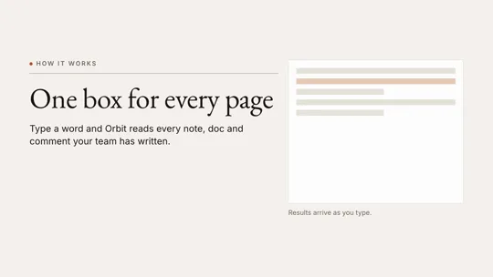
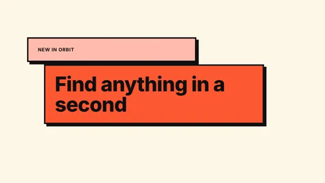
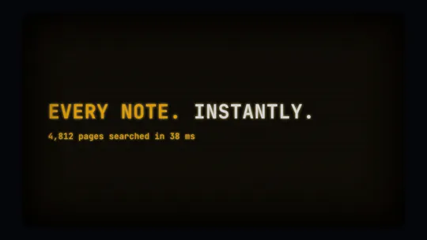
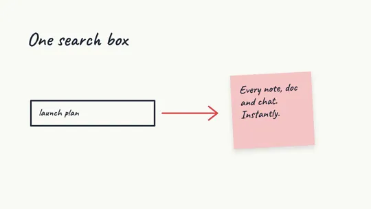
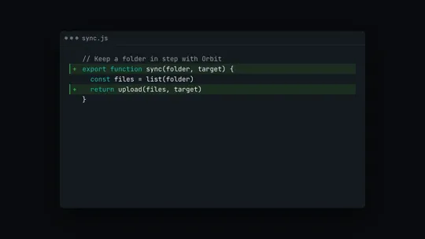
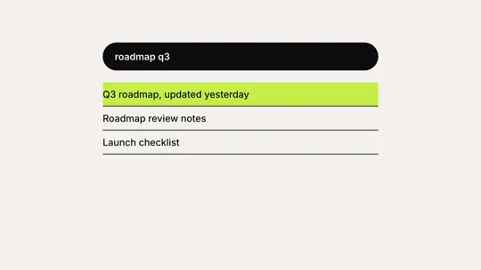
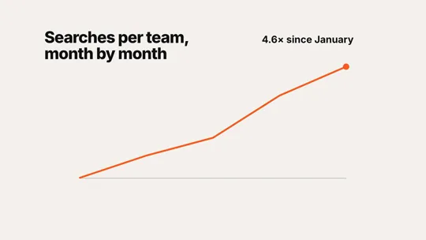
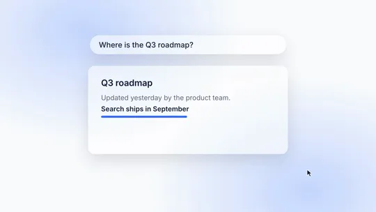
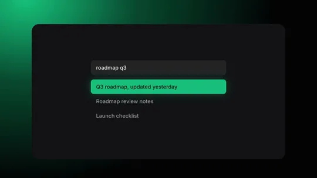
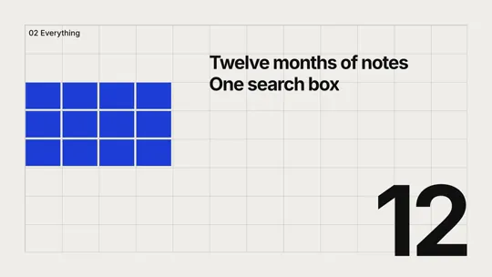

# Video Agent

[](https://app.netlify.com/start/deploy?repository=https://github.com/netlify-labs/video-agent)

Your company's own video agent. Describe a video and get an MP4 a few minutes later. An AI agent builds it as a web
page with [HyperFrames](https://hyperframes.heygen.com) and renders it in a
[Netlify Agent Runner](https://docs.netlify.com/build/build-with-ai/agent-runners/overview/). Revise it in plain
words, share it with a link, or make videos from scripts, CI and AI tools.

<p>
  <a href="app/looks/clean/LOOK.md"></a>
  <a href="app/looks/editorial/LOOK.md"></a>
  <a href="app/looks/data-story/LOOK.md"></a>
  <a href="app/looks/bold-blocks/LOOK.md"></a>
  <a href="app/looks/retro-crt/LOOK.md"></a>
  <a href="app/looks/whiteboard/LOOK.md"></a>
  <a href="app/looks/kinetic/LOOK.md"></a>
  <a href="app/looks/terminal/LOOK.md"></a>
  <a href="app/looks/one-take/LOOK.md"></a>
  <a href="app/looks/follow-the-dot/LOOK.md"></a>
  <a href="app/looks/soft-glass/LOOK.md"></a>
  <a href="app/looks/dark-stage/LOOK.md"></a>
  <a href="app/looks/riso-print/LOOK.md"></a>
  <a href="app/looks/swiss-grid/LOOK.md"></a>
</p>

Each video can use one of these looks. To add your own, see [app/looks/README.md](app/looks/README.md).

## What it does

- **Make and revise.** Write a prompt, pick a shape (16:9, 9:16, 1:1 or 4:5), then ask for changes like "make the
  end card orange". Every revision is a new version.
- **Redo one scene.** Change the scenes you pick and keep the rest exactly as it was.
  ([Redo a scene](docs/guides/redo-a-scene.md))
- **Remix.** Start a new video from a finished one: same video with a new product name, or same format on a new
  topic. ([Remix](docs/guides/remix.md))
- **Demos from screen recordings.** Upload a recording and get a product demo with zoom, a smooth cursor, callouts
  and private areas hidden. ([Screen recordings](docs/guides/screen-recordings.md))
- **Your own voice.** Record narration in the browser while the video plays. ([Voice-over](docs/guides/voice-over.md))
- **Your brand.** Fonts, colours, logos and product facts in [`context/`](context/README.md) apply to every video.
- **Music.** CC0 and CC BY tracks from Openverse, credited for you. ([Music](docs/guides/music.md))
- **Sharing.** Any version can get a public share page, an MP4 link, a GIF and an embed snippet.
- **A team app.** Sign-in limited to your company, roles, comments and approvals.

## Try it on your laptop

You don't need a deployment for this. The `video-agent` CLI makes videos on your machine with your own
[Claude Code](https://claude.com/claude-code), inside a sandbox. It needs Node 22 or later.

```sh
npm install -g netlify-video-agent
video-agent doctor
video-agent local "A 20-second launch video for our webhooks feature" --aspect 16:9
video-agent local revise ./videos/webhooks-launch "Make the end card orange"
```

Each version lands in `./videos/<name>/vN/`. If you have a `./context/` folder, it's used as your brand. Nothing is
sent to Netlify, and it uses your agent subscription instead of credits.

## Deploy it for your team

You need:

- A Netlify team on a credit-based plan with Agent Runners. If a project in the team has an **Agent Runs** tab,
  you're set. A video costs about 90 to 210 AI credits.
- A GitHub account. Agent Runners work from Git.
- A Netlify personal access token, ideally from an account made just for this.

Press **Deploy to Netlify** above and fill in three values. You can leave them empty and add them later.

| Variable                | Value                                                          |
| ----------------------- | -------------------------------------------------------------- |
| `RUNNER_API_TOKEN`      | The personal access token.                                     |
| `ALLOWED_EMAIL_DOMAINS` | Who can sign up, like `acme.com,acme.co.uk`, or `invite-only`. |
| `ADMIN_EMAILS`          | The first admins' email addresses.                             |

Then enable Identity on the project and open `https://<your-site>/setup`. It checks everything and tells you what's
left. The [deploy guide](docs/guides/deploy.md) covers deploying from a clone, sign-in with Netlify accounts, roles,
the trust model and every setting.

## How it works

```
prompt ─► POST /api/v1/videos ─► queue ─► Agent Runner run (on this same project, from the production deploy)
                                            │ reads context/, writes video/index.html, `hyperframes check`
                                            │ scripts/render-job.ts: render → poster, GIF, captions → upload to Blobs
                                            ▼
          web app / API ◄── ready ◄── finalize (verify hashes and the MP4) ◄── callback + a sweep every minute
```

- One repo, one Netlify project. Records live in Netlify Database and files in Netlify Blobs.
- Up to 3 runs go at once (`MAX_ACTIVE_RUNS`). The rest wait in a queue.
- A sweep every minute catches lost callbacks, crashed starts and runs that go too long. Nothing retries on its own;
  people get a **Try again** button.
- Runs can read the project's environment variables and Blobs, like any Netlify build. Read the
  [trust model](docs/guides/deploy.md#trust-model-plainly) before you deploy.

## Use it from code, CI and AI tools

With the CLI from [Try it on your laptop](#try-it-on-your-laptop) or the SDK:

```sh
video-agent login --url https://<site>
video-agent create "A 20-second launch video for our new webhooks feature" --aspect 16:9 --wait --out ./webhooks
```

```ts
import { VideoAgent } from 'netlify-video-agent-sdk'
const va = new VideoAgent({ url: 'https://<site>', apiKey: process.env.VIDEO_AGENT_KEY })
const video = await va.videos.create({ prompt: 'A 20-second launch video for webhooks', aspect: '16:9' })
await va.files.download(await va.videos.wait(video.id), { file: 'video', to: './webhooks.mp4' })
```

There's also a REST API with signed webhooks, a [GitHub Action](packages/action/README.md) that makes demo videos for
pull requests, and an MCP server for Claude, Cursor and other AI tools. See [API and CI](docs/guides/api.md) and
[AI tools](docs/guides/ai-tools.md). Every deployment has the same docs at `/docs`, with its own URL filled in.

## Guides

| Guide                                                 | What's in it                                                     |
| ----------------------------------------------------- | ---------------------------------------------------------------- |
| [Deploy and run your own](docs/guides/deploy.md)      | Setup, sign-in, roles, private videos, trust model, settings     |
| [Remix](docs/guides/remix.md)                         | What a remix keeps, privacy, the API                             |
| [Screen recordings](docs/guides/screen-recordings.md) | Recording format, hidden areas, privacy mode, quick demos        |
| [Redo a scene](docs/guides/redo-a-scene.md)           | What stays frozen, limits, the CLI and SDK                       |
| [Voice-over](docs/guides/voice-over.md)               | Recording takes, tracks, retention, transcription                |
| [Music](docs/guides/music.md)                         | Openverse search, licences, credits, starter music               |
| [Remotion](docs/guides/remotion.md)                   | The optional second engine and its license                       |
| [API and CI](docs/guides/api.md)                      | CLI, SDK, REST, webhooks, the GitHub Action                      |
| [AI tools](docs/guides/ai-tools.md)                   | MCP tools, WebMCP, the agent skill, Sign in with Netlify for MCP |
| [Live tests](docs/guides/live-tests.md)               | Scripts that check a deployed site                               |

## Developing

```sh
npm ci
npm test                            # unit and integration tests
npm run typecheck && npm run lint
npm run openapi:gen                 # after changing API routes
npm run db:generate                 # after changing app/server/store/schema.ts
ALLOW_NON_PRODUCTION=true npx netlify dev
```

| Folder      | What's in it                                                                                |
| ----------- | ------------------------------------------------------------------------------------------- |
| `app/`      | The service: API and MCP server, web app, tests, looks and the Remotion template            |
| `context/`  | Your brand and product facts. Every run reads it.                                           |
| `video/`    | The HyperFrames project each run starts from                                                |
| `scripts/`  | Build and setup tools, and the scripts agent runs call                                      |
| `skills/`   | The agent skills each deployment serves at `/skills/`: `create-video` and `video-agent-cli` |
| `netlify/`  | Functions, edge functions and database migrations                                           |
| `packages/` | The CLI, SDK, player and GitHub Action                                                      |
| `docs/`     | These guides, how releases work and an example publish destination                          |

To contribute, see [CONTRIBUTING](.github/CONTRIBUTING.md). Adding a look is a good first pull request.

## License

MIT. Third-party pieces keep their own licences: IBM Plex fonts (SIL Open Font License 1.1), Scalar (MIT), Mantine
(MIT) and HyperFrames (see its package). The template ships no Netlify brand assets: `context/` stays neutral until
you fill it in.
