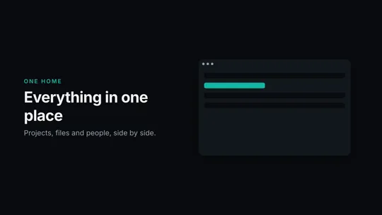
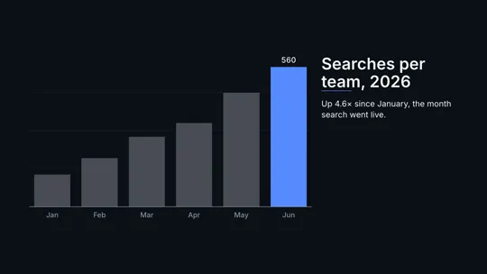
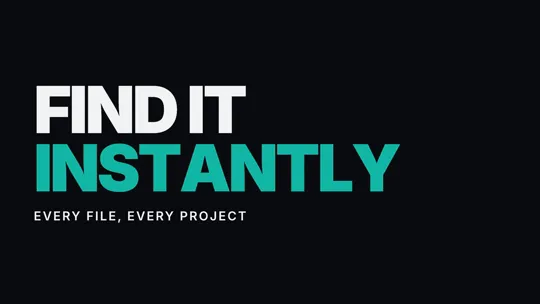

# Video Agent

[](https://app.netlify.com/start/deploy?repository=https://github.com/netlify-labs/video-agent)

Your company's own video agent on Netlify. Your team signs in, describes a video, and gets an MP4 a few
minutes later, made by an AI agent with [HyperFrames](https://hyperframes.heygen.com) (an open-source HTML-to-video renderer;
no account needed) in a
[Netlify Agent Runner](https://docs.netlify.com/build/build-with-ai/agent-runners/overview/). Revise it
in plain words, publish it to a public link with a share page, or drive everything from scripts with an
API key.

## What you get

- **A web app** for your team: write a prompt, pick a shape (16:9, 9:16, 1:1, 4:5), watch it being made, play and download the result (MP4, poster, GIF preview, captions).
- **Revisions:** "make the end card orange" starts a new version from the previous one's composition. Every version keeps its prompt and author.
- **Remix:** a new video of your own that starts from someone's finished video, from "the same video with our new
  product name" to "this format, about webhooks" ([below](#remix-a-video)).
- **Publishing:** any version can get a public share page (with link previews for Slack and social), a raw MP4 URL, a GIF and an embed snippet. Unpublishing takes the link down immediately.
- **An API** with API keys and signed webhooks, so CI and scripts can make videos too. Its reference is built into the app (**API docs**).
- **MCP tools**, so people can ask Claude, Cursor or any MCP client for a video.
- **Your brand:** put your brand guide, logos and fonts in [`context/`](context/README.md). Every video follows it.
- **A media library** of logos, screenshots, clips, fonts and music, with **Find music**: CC0 and CC BY tracks from
  [Openverse](https://openverse.org), credited automatically ([below](#music-from-openverse)).

## Before you deploy

Have these ready before you press the button:

- A Netlify team on a **credit-based plan** with **AI features** and **Agent Runners** available, and AI credits.
  To check, open any project in the team: if it has an **Agent Runs** tab, you're set. Each video costs roughly
  90–210 credits in our tests (more for long or complex videos), billed to the team's AI credits; nothing else is
  billed. There are **no spending limits in this template**: use your team's credit controls.
- A **GitHub** account. The project must be connected to a GitHub repo, because Agent Runners work from Git.
- A **personal access token** for starting runs. We recommend a dedicated Netlify account for it: invite that
  account to your team first, sign in as it, then create the token at
  [User settings → Applications](https://app.netlify.com/user/applications). It's a user-level token: anyone who
  can read this project's environment can use it.

## Deploy

**With the button:** press Deploy to Netlify above. It copies this repo to your GitHub and asks for the three settings
the agent needs to make videos. Don't have them ready? Leave them empty: the site still deploys, and you can add them
later under Project configuration > Environment variables (then redeploy). The `/setup` page lists anything missing.

| Variable                | What to enter                                                                            |
| ----------------------- | ---------------------------------------------------------------------------------------- |
| `RUNNER_API_TOKEN`      | The personal access token.                                                               |
| `ALLOWED_EMAIL_DOMAINS` | Your company's email domains, comma-separated (`acme.com,acme.co.uk`), or `invite-only`. |
| `ADMIN_EMAILS`          | The first admins' email addresses, comma-separated.                                      |

Then follow the page Netlify shows after the deploy (it's [`USAGE.md`](USAGE.md)): enable **Identity**, set its
registration mode, open `https://<your-site>/setup` and create the first admin account. The setup page checks
everything and links to whatever is left.

**From a clone:** push the clone to a GitHub repo of your own first, then:

```sh
npm ci
npx netlify login
npm run setup -- --team <your-team-slug>   # or --site <existing project> to reuse one
```

`npm run setup` creates (or reuses) the project, asks for the three values above, saves them, enables Identity,
offers to register an Openverse app for music search and, once the project is connected to your GitHub repo, starts a production build and runs the setup checks. The
first time, it stops and tells you where to link the repo; run it again with the `--site` it prints. Then
follow steps 1 and 3 of [`USAGE.md`](USAGE.md) for the registration mode and the first admin.

Either way, the database (Netlify Database) is created and its tables are migrated automatically by the
production build from Git (the migrations are in `netlify/database/migrations/`). There's nothing to run by hand.

## Who can sign in

Sign-in uses [Netlify Identity](https://docs.netlify.com/manage/security/secure-access-to-sites/identity/overview/)
by default. A deployment can use **Sign in with Netlify** (Netlify OAuth) instead, optionally limited to members of a
Netlify team: see [Sign in with Netlify for the web app](#sign-in-with-netlify-for-the-web-app). Forks keep Identity
unless they set `AUTH_PROVIDER=netlify`.

With Identity, `ALLOWED_EMAIL_DOMAINS` picks one of two modes:

- **Company domains** (`acme.com`): anyone with an `@acme.com` address can create an account and must confirm their email. Keep Identity's **autoconfirm off**, or people could claim addresses they don't own. Other domains are refused at sign-up and by the API.
- **`invite-only`**: set Identity registration to **Invite only** and invite people from the Identity tab. Nobody else can sign up.

`ADMIN_EMAILS` become admins on their first sign-in; everyone else joins as a **Creator**. Admins change roles on the
Admin page:

| Role         | Can                                                                                                             |
| ------------ | --------------------------------------------------------------------------------------------------------------- |
| **Admin**    | Everything: people and roles, settings, usage, stopping runs, owner actions on any video                        |
| **Creator**  | Make, revise, remix and plan videos (spends credits); rename, publish, delete and make private their own videos |
| **Reviewer** | Watch videos and give feedback; never spends credits                                                            |
| **Viewer**   | Watch videos                                                                                                    |

API keys and the MCP server act with their owner's role. Disabling someone also revokes their API keys.

**Private videos** are hidden from everyone except their owner and admins: they don't appear in other people's
Library, search, API or MCP results. Private means hidden in the app among trusted colleagues, not confidential:
agent runs in this project can read the project's storage, so a Creator could have a run fetch another video's files.
A private video can still be published to a public link; publishing is a separate, explicit step.

## How it works

```
prompt ─► POST /api/v1/videos ─► queue ─► Agent Runner run (on this same project, from the production deploy)
                                            │ reads context/, writes video/index.html, `hyperframes check`
                                            │ scripts/render-job.ts: render → poster, GIF, captions → upload to Blobs
                                            ▼
          web app / API ◄── ready ◄── finalize (verify hashes and the MP4) ◄── callback + a sweep every minute
```

- One repo, one Netlify project. Records live in Netlify Database, files in Netlify Blobs.
- At most `MAX_ACTIVE_RUNS` (default 3) runs at once; the rest wait in a queue.
- A scheduled sweep (every minute) owns every outcome: lost callbacks, crashed starts, runs that ask questions or run too long are all handled. Nothing retries automatically; people get a **Try again** button.
- Only the published production deploy serves the API and files. Deploy previews (including the ones agent runs create) get a copy of the database, so they serve nothing.

### Trust model, plainly

Agent runs in this project can read the project's environment variables, like any Netlify build. That includes
`RUNNER_API_TOKEN`. Only signed-in people from your allowed domains (or invited people) can start runs, and every
output is verified (hashes against the run's authenticated report, a real MP4 check) before it becomes a video.
Prompts are visible to your Netlify team in the project's Agent Runs page.
Runs can also read the project's Blobs, so they can read uploaded media, including voice-over recordings.
A run renders offline, with one exception: when [Remotion](#experimental-the-remotion-engine-bring-your-own-license) is
on, each Remotion render reports to remotion.pro which license key was used, the kind of event and whether it was
production or development.
Looks are instructions to the agent, like `context/`, so only people who can change the repo add them.

## Configuration

| Variable                                                 | Required?                                      | Default                                        | Meaning                                                                                                                                                  |
| -------------------------------------------------------- | ---------------------------------------------- | ---------------------------------------------- | -------------------------------------------------------------------------------------------------------------------------------------------------------- |
| `RUNNER_API_TOKEN`                                       | **Required**                                   | —                                              | Personal access token for starting and watching runs.                                                                                                    |
| `ALLOWED_EMAIL_DOMAINS`                                  | **Required**                                   | —                                              | Company domains, or `invite-only`.                                                                                                                       |
| `ADMIN_EMAILS`                                           | **Required**                                   | —                                              | First admins.                                                                                                                                            |
| `MAX_ACTIVE_RUNS`                                        | Optional                                       | `3`                                            | Runs at once.                                                                                                                                            |
| `AGENT`, `AGENT_MODEL`, `AGENT_EFFORT`                   | Optional                                       | runner default                                 | Which agent makes videos.                                                                                                                                |
| `SCOPED_AGENT_MODEL`, `SCOPED_AGENT_EFFORT`              | Optional                                       | the deployment's model                         | Model and effort for scoped revisions ([Redo a scene](#redo-a-scene)), on revise and retry.                                                              |
| `AUTHORING_DEADLINE_MIN`                                 | Optional                                       | `22`                                           | Stop a run after this many minutes (the runner's ceiling is 25).                                                                                         |
| `QUEUE_TIMEOUT_MIN`                                      | Optional                                       | `60`                                           | Fail a video that waits in the queue longer than this.                                                                                                   |
| `RENDER_QUALITY`                                         | Optional                                       | `standard`                                     | HyperFrames render quality (`looks`, `standard`, `delivery`).                                                                                            |
| `ALLOWED_ORIGINS`                                        | Optional                                       | —                                              | Origins allowed to call the API from a browser with an API key (CORS).                                                                                   |
| `BRAND_ZIP_URL`                                          | Optional                                       | —                                              | A zip of your brand kit, used instead of committing it to `context/` ([how](context/README.md#keeping-your-brand-out-of-the-repo)).                      |
| `AUTH_PROVIDER`                                          | Optional                                       | `identity`                                     | How people sign in to the web app: `identity` (Netlify Identity) or `netlify` ([Sign in with Netlify](#sign-in-with-netlify-for-the-web-app)).           |
| `NETLIFY_REQUIRED_TEAM`                                  | Optional                                       | —                                              | Netlify team slugs or ids (comma-separated). When set, every Netlify sign-in (web or MCP) must be a member of one; re-checked daily.                     |
| `MCP_OAUTH_PROVIDER`                                     | Optional                                       | `netlify` with `AUTH_PROVIDER=netlify`, else — | `netlify` turns on OAuth for the MCP ([below](#sign-in-with-netlify-oauth)); `off` turns it off. Off unless both credentials are set.                    |
| `NETLIFY_OAUTH_CLIENT_ID`, `NETLIFY_OAUTH_CLIENT_SECRET` | Optional (needed with `AUTH_PROVIDER=netlify`) | —                                              | The Netlify OAuth application for Sign in with Netlify (web and MCP share it).                                                                           |
| `MCP_OAUTH_ALLOWED_EMAIL_DOMAINS`                        | Optional                                       | `ALLOWED_EMAIL_DOMAINS`                        | Email domains that may connect over OAuth. With neither set to domains (`invite-only`), only existing accounts can.                                      |
| `MCP_OAUTH_CIMD_HOSTS`                                   | Optional                                       | `claude.ai,claude.com`                         | Hosts whose https client ids (Client ID Metadata Documents) are fetched.                                                                                 |
| `OPENVERSE_CLIENT_ID`, `OPENVERSE_CLIENT_SECRET`         | Optional                                       | —                                              | A registered Openverse app for Find music and runs' music (higher rate limits). Without them, searches are anonymous ([below](#music-from-openverse)).   |
| `ELEVENLABS_API_KEY`                                     | Optional                                       | —                                              | ElevenLabs voices (with word timings) for voice-overs. Without it, voice-overs use Kokoro, which is built in. Agent runs read it, so scope it to builds. |
| `ENGINES`                                                | Optional                                       | `hyperframes`                                  | Engines this deployment may offer. Add `remotion` only with its license ([below](#experimental-the-remotion-engine-bring-your-own-license)).             |
| `VIDEO_AGENT_REMOTION_KEY`                               | Optional (for a Company License)               | —                                              | Your Remotion key (`rm_sec_…`). Secret; not `REMOTION_`-prefixed, so Remotion never hands it to video code.                                              |
| `VIDEO_AGENT_REMOTION_DEVELOPMENT`                       | Optional (test deployments only)               | —                                              | `1` marks this deployment's Remotion renders as development ones.                                                                                        |

## Looks

<p>
  <a href="looks/clean/LOOK.md"></a>
  <a href="looks/editorial/LOOK.md"></a>
  <a href="looks/data-story/LOOK.md"></a>
  <a href="looks/kinetic/LOOK.md"></a>
  <a href="looks/terminal/LOOK.md"></a>
</p>

A look is a style for a video: its type, colour roles, motion and layout rules. People pick one on New video, restyle
a video into another, or leave it to the admin default (none unless an admin picks one). Every look in a deployment,
with its preview, is under **Docs → Looks** (`/docs/looks`). To add one, see [looks/README.md](looks/README.md).

## Remix a video

**Remix** makes a new video, owned by you, that starts from another video's finished composition and changes it as
you say. There's no mode to pick: "keep everything, but call the product Orbitly" changes just that, and "same format,
about our payments API" rewrites the script and on-screen text and keeps the style. Remix is on a video's page, in a
Library tile's **⋯** menu, on its share page (only for signed-in people who can create) and under **New video → Start
from an existing video**.

- **What carries over:** the composition, and the source's shape, length, sound, AI voice-over settings, language and
  library media, each of which you can change before you start. The run applies today's brand from `context/`.
- **What doesn't:** recorded narration is removed from the copy, so the remix has no recorded voice until you record
  one. Comments, verdicts, publications and the source's webhook stay with the original.
- **The remix is its own copy.** Deleting or revising the original doesn't change it. It shows "Remix of _title_ vN",
  linked to the source when you can still see it.
- **Private stays private.** Only people who can see a video can remix it, so a private video can be remixed by its
  owner and admins, and its remix starts private. An admin who remixes someone's private video gets a copy of its
  content and prompt history; the owner isn't notified.
- **Credits:** a remix is an agent run, so it spends credits like any other.
- **Admin switch:** **People can remix videos** on the Admin page turns it off for everyone, without a redeploy.
  Remix disappears from the app, and the API, plans and MCP refuse (`409 remix_disabled`). Remixes already queued
  still run.

From scripts, `POST /api/v1/videos/{id}/remix` with `{"prompt": "…"}` and, optionally, `fromVersion` (default: the
latest ready version), `aspect`, `durationSec`, `language`, `sound`, `voiceover`, `mediaIds` (replaces the source's
set), `planId` and `webhookUrl`. It takes an `Idempotency-Key` header and returns 202 with the new video. From AI
tools, it's the `remix_video` MCP tool.

## Redo a scene

A **scoped revision** redoes one or more scenes of a finished version and leaves the rest alone. Pick the scenes, say
what should change, and you get a new version where only those scenes were rewritten. Everything else in the
composition is copied from the version you started from, not regenerated.

- **What's guaranteed:** the saved composition outside the picked scenes is the parent's, byte for byte. The run gets
  a spliced copy where the frozen scenes are put back verbatim, and finalize checks that again before it stores
  anything. A run that changes a frozen scene is refused, nothing is stored, and **Try again** tells the next run
  what it touched.
- **What's checked more loosely:** the rendered MP4 is checked by length (within a quarter of a second of the
  spliced composition). Pixels in frozen scenes aren't compared frame by frame on every run; the redo-a-scene live
  test measures how far they drift.
- **Limits:**
  - The version must keep the editing contract (the versions you can **Edit** in the browser) and be made with
    HyperFrames.
  - Pick 1 to 20 scenes, and not every scene: that's a whole-video revision.
  - Name the version the scenes are from (`fromVersion`), since scene ids belong to one version.
  - Length, sound, voice-over and plans stay the parent's. Say in the request if a scene should run longer; the
    scenes after it move.
  - The scene that ends the video under recorded narration holds its last frame, so it's redone only with a
    whole-video revision.
  - Fonts, shared classes and colour roles are frozen too. A redone scene may restyle itself, never the rest of the
    video.
- **Credits:** it's an agent run, so it costs about what a revision does, sometimes more. In our tests it cost 50–67
  credits per run, against 36 for a whole-video revision of the same request. You pay for the guarantee that the
  rest stays as it was, not for a discount.

**Where to find it:**

- On a video's page, **Revise** has **Whole video** and **Some scenes**: the version's scenes are chips with their
  times.
- On a pinned comment, **Redo this part** (owners and admins) opens the same choice with that comment's scene picked.
- **Incorporate feedback** offers **Only change the scenes these comments point at** when every comment you pick is
  pinned.
- History shows what each scoped version redid ("Redid Features").

From scripts, list a version's scenes with `GET /api/v1/videos/{id}/versions/{n}/beats` (or read `beats` on the
version), then `POST /api/v1/videos/{id}/versions` with `{"prompt": "…", "fromVersion": n, "scope": {"beats": ["demo"]}}`.
A version that can't be redone scene by scene answers `409 not_editable`. `/api/v1/config` lists `scoped_revision`
when the deployment supports it. From AI tools, pass `beats` (with `from_version`) to the `revise_video` MCP tool.
`get_video` lists each version's scenes. From the SDK:

```ts
await va.videos.redoScenes(id, { beats: ['demo'], prompt: 'Show the preview URL' }) // from the latest ready version
```

From the CLI, a scene is its id or its label:

```sh
video-agent scenes vid_…                                   # ids, labels and times
video-agent redo vid_… --scene demo "Show the preview URL" --wait
video-agent revise vid_… --scene Opening --scene outro "Brighter" --from-version 2
```

## Your own voice-over

Creators can narrate a video themselves: open **Edit → Narration**, record while the video plays (or drop in an
audio file), re-record any stretch, and render. **Keep my visuals** re-renders the same picture with your voice (a
render-unchanged run); **Fit the video to my narration** lets the agent retime the scenes to your words (a full
run, and it always replaces the AI voice-over). Captions come from your recording.

- **Recording needs HTTPS** (browsers only give the microphone to secure pages; the setup page checks it) and the app
  sends `Permissions-Policy: microphone=(self)`. Share, embed and preview pages never get the microphone.
- **Where recordings live:** in this project's Netlify Blobs (`media` store), like other uploads. A raw recording is
  readable by the person who recorded it and by admins. Once a recording is used on a video (on the Narration track
  of a version, or of its recorder's saved draft), Creators who can see that video can hear and re-cut it. Reviewers
  and viewers only ever get the rendered video and its `narration.mp3`, never the raw takes. Unused recordings stay
  private.
- **Retention:** a recording that nothing uses any more is deleted 30 days after its last use (or right away with
  **Delete unused recordings** on the Media page). Each person can store up to 2 GiB of recordings by default.
  Screen recordings (for demos) follow the same rule: deleted 30 days after upload if no video used them, or 30 days
  after the last video using them was deleted, together with their pointer trace; they have their own 2 GiB budget
  per person, set next to the voice recordings' on the Admin page.
- **Transcription** runs inside the render, locally, with NVIDIA's
  [Parakeet TDT 0.6B v3](https://huggingface.co/nvidia/parakeet-tdt-0.6b-v3) model (CC-BY-4.0) through HyperFrames;
  nothing leaves the run. An admin can switch transcription to ElevenLabs (it then sends the narration to ElevenLabs;
  this is separate from using ElevenLabs voices) or turn it off.
- **Admin settings** (Admin page, no redeploy): turn recorded voice-over off for everyone, choose the transcription
  provider, and set the per-person recording quota.
- As with every upload here, agent runs can read the project's storage (see the trust model above), so app-level
  privacy is between people using the app, not a wall against runs.

## Music from Openverse

Creators and admins can search [Openverse](https://openverse.org) from the Media page (**Find music**), the media
picker, or the MCP tools `search_music` and `import_music`. Every call goes through the server
(`GET /api/v1/media/openverse/search`, `POST /api/v1/media/openverse/import`); the browser never talks to the
Openverse API.

- **Slow Openverse.** Openverse's audio search can take a minute, longer than an API request may run. A request
  tries for 6 seconds; if Openverse hasn't answered by then, it answers `202` with a job (and a `Location` header,
  `/api/v1/media/openverse/jobs/{id}`). The `openverse-background` function runs it with 60-second calls, retries
  timeouts and 5xx with backoff, and waits out a 429's `Retry-After`. Poll the job until `status` is `done` (with
  `search` or `media`) or `failed` (with `error`). Only the person who started a job can read it; jobs are kept for 30
  minutes. Identical requests share a job, and each person can start 12 searches or imports a minute. The MCP tools
  wait about 8 seconds, then answer `status: "pending"` with a `job_id` for `get_music_job`.
- **Stored searches.** Every search Openverse answers is stored in the database (`openverse_searches`, keyed by the
  search with case, spaces, licence, kind and page normalized) and answers the same search from anyone, on any
  function instance, at once: fresh for 24 hours, then for up to 14 days marked `stale: true` (with `fetchedAt`) while
  one background job refreshes it. Only the tracks are stored; whether one is in the library (`mediaId`) is looked up
  for every request. The server's music picks use the same stored searches. The sweep deletes searches older than 14
  days and keeps at most 5,000.
- **Daily warm-up.** The `openverse-warmup` function (daily, 05:17 UTC) queues one background job that refreshes the
  common searches (`GET /api/v1/media/openverse/common`: upbeat, ambient, corporate, cinematic, acoustic, piano, lofi
  and more; music, CC0 and CC BY, first page) and the 15 most used first-page searches of the last 14 days, skipping
  any fetched in the last 20 hours. It runs three at a time, starts each at least 4 seconds after the last, and stops
  when Openverse says it's busy. Find music offers the common searches as quick picks.
- **Library first.** `GET /api/v1/media/openverse/library?q=` returns ready audio already in the library whose title,
  caption, filename, creator or source title matches the words (every word matched first, then Openverse imports),
  without asking Openverse. Find music shows them at once under **In your library**, above Openverse's tracks, and
  `search_music` lists them in `in_library` so agents reuse a track before importing another.
- **Licences: CC0 and CC BY only.** NC (non-commercial), ND (no derivatives) and SA (share-alike) tracks are never
  shown or imported, whatever Openverse returns: videos are often commercial, they're edited and re-cut, and a
  share-alike track would put its licence on the whole video. CC0 needs no credit; CC BY needs one, which the app adds.
- **Import** takes only the Openverse id. The server reads the track from Openverse again, checks the licence,
  downloads the file over HTTPS (at most 3 redirects, 50 MB, 25 seconds or 3 minutes in a job; hosts that resolve to
  private addresses are refused) and keeps it only if its bytes are MP3, M4A, WAV or Ogg audio of 10 minutes or less. It becomes a normal
  library item with its source, licence, creator and Openverse's attribution recorded. Importing the same track again
  returns the same item.
- **Attribution** comes from the library, not from the agent: a version made with a CC BY item lists it in the
  version's `credits`, the video page shows "Music: _title_ by _creator_, CC BY 4.0" with links, and the public share
  page and the embed snippet carry the same line. A silent version isn't credited for a track it never used.
- **Before runs.** When Sound is Music (or Music + effects) and the version has no track, picked or inherited, and
  the brand has none, the server picks one before the run starts: the attempt shows **Finding music…** (stage
  `finding_music`) while background Openverse jobs search with a short query (from the AI Gateway's fast model when
  it's available, else mood words in the request) and import the best CC0 or CC BY track, long enough for the video
  if possible. It joins the version's media like a picked track, owned by the version's author, so it's credited the
  same way. A search that fails or finds nothing importable moves on to the next words, one at a time: the query,
  its fallback, then broad searches ("upbeat electronic", "ambient", "corporate", "acoustic", "cinematic") ordered to
  suit the request's mood; each is listed in the pick's `tried`. These searches don't retry, since a query Openverse
  times out on usually keeps timing out. When no Openverse track is chosen within 5 minutes, every search is spent or
  three fail in a row, the server uses the best audio already in the team library instead (ready items only, the
  ones everyone in the team sees): Openverse imports first, since they're licensed and credited, then titles and
  captions that match the mood, then tracks long enough for the video, then the most recently used or added. The pick
  shows `source: "library"` and the video page "Music: _title_ (from your library)". Only an empty library (no audio
  at all) starts the run without a track, and it finds music itself (below). Revisions inherit the track; a version
  can be cancelled while it's finding music.
- **Starter music.** To give that fallback something to use, seed the library with tracks across moods
  (upbeat, ambient, corporate, cinematic, acoustic, playful, inspiring, lofi). It's optional and not part of
  `npm run setup`:

  ```sh
  VIDEO_AGENT_KEY=<a Creator's or admin's API key> npm run seed:music -- --site <your project or its https URL> [--count 12] [--cc0-only]
  ```

  It goes through the site's own Openverse endpoints like Find music: searches each mood for CC0 and CC BY tracks of 30
  seconds to 4 minutes the library can take (CC0 first), imports them with captions naming the mood (which the fallback matches), follows
  `202` jobs, waits out 429s and slow answers with backoff, skips tracks already in the library, and prints what it
  imported (title, creator, licence, length). CC BY tracks are credited automatically on videos that use them (most music on
  Openverse is CC BY); pass `--cc0-only` if you want no credit lines. A project id or name is
  looked up with your Netlify login; an https URL is used as is.

- **In runs.** When the server's pick found nothing, not even in the library (or the version predates it), the agent finds a track itself with
  `scripts/openverse.ts` (same licence rules, files over HTTPS up to 10 MB so they fit the preview bundle, CC0 first).
  The script records each file's licence in the composition's `assets/music/credits.json`; finalize reads it from the
  saved composition, keeps only valid CC0/CC BY entries for files an `<audio>` plays, and stores them on the version,
  so those tracks are credited like library ones, also after revisions and edits. Runs use the same
  `OPENVERSE_CLIENT_ID`/`OPENVERSE_CLIENT_SECRET` (set for builds as well as functions) or search anonymously.
- **Previews** play from the track's source site (Jamendo, Freesound, Wikimedia Commons) when someone presses play.
- **Rate limits.** Anonymous Openverse access is limited per IP address, and Netlify Functions share outbound
  addresses, so register an app for steady use. One command does it and stores the credentials on your project
  (the secret is never printed):

  ```sh
  npm run setup:openverse -- --site <your project> --deploy
  ```

  It uses your Netlify login's email for Openverse (or `--email` / `OPENVERSE_EMAIL`), registers an app named after your site (names are unique
  across Openverse; pass `--name` to choose another), sets `OPENVERSE_CLIENT_ID` and `OPENVERSE_CLIENT_SECRET`,
  and with `--deploy` redeploys so the functions pick them up. Then click the verification link Openverse emails
  you: until then the app has anonymous limits. `npm run setup` offers the same step, and the setup page shows
  whether searches run as a registered app. The server swaps the credentials for a token and keeps it until it
  expires. Searches are stored (above), and when Openverse says it's busy the app waits before asking again and says
  "Openverse is busy, try again in a minute."

## Experimental: the Remotion engine (bring your own license)

Videos are made with [HyperFrames](https://hyperframes.heygen.com) (HTML, CSS and GSAP, Apache-2.0), and that stays the
default. A deployment can also offer [Remotion](https://www.remotion.dev) (React), which suits 3D, maps and data-heavy
looks. It's off and hidden unless you turn it on, and you need your own Remotion license to use it.

**Remotion isn't open source.** In the app's own words:

> Remotion isn't open source. It's free for individuals, non-profits and companies of up to 3 people, counting the
> people from other teams or contractors you work with on it. Every other company needs a Remotion Company License
> before using it here. For this app that's usually "Remotion for Automators" ($0.01 a render, $100 a month minimum, at
> remotion.pro), and it also covers the Remotion Player the editor uses. Video Agent doesn't buy or check this for you.

| Your organisation                                                                              | License                                                                       |
| ---------------------------------------------------------------------------------------------- | ----------------------------------------------------------------------------- |
| Individuals, non-profits, companies of up to 3 people (counting collaborators and contractors) | Remotion's Free License                                                       |
| Everyone else                                                                                  | A Remotion Company License (Automators: $0.01 a render, $100 a month minimum) |

This template is MIT and doesn't include Remotion: a run installs it from npm only when `ENGINES` includes it.

**Turning it on takes two steps:**

1. Add `remotion` to `ENGINES` on the project (and, for a Company License, set `VIDEO_AGENT_REMOTION_KEY`). Redeploy.
2. On **Admin**, switch on **Use Remotion** and choose your license. The app records who chose it and when; it never
   stores the key, it only checks that it's set.

**What each render reports.** Remotion counts every render, including the stills a run looks at while it works. Each
one tells remotion.pro the license key (or `free-license`), the kind of event and whether it was production or
development; Remotion keeps that indefinitely. It never sends what's in the video, and for these server-side renders no
domain or IP address. If a key ever shows up in a run's output, rotate it on remotion.pro. The Admin page shows this
month's Remotion render count; reconcile it with remotion.pro, since Video Agent doesn't know how Remotion bills them.

**What works.** Remotion videos are made, revised and played like any other, silent or with a music bed. Editing them
in the browser, sound effects and voice-overs come later. **Turning it off** stops new Remotion videos; existing ones
keep playing. Without `remotion` in `ENGINES`, their new runs fail with `engine_unavailable`.

## The API

Reference: the app's **API docs → REST API** page (`/docs/api`), built from the OpenAPI spec at `/api/openapi.json` (committed as
[`ui/src/api/openapi.json`](ui/src/api/openapi.json)). A standalone copy is at `/api/docs`.

```sh
KEY=nva_...   # create one on the API keys page
curl -X POST https://<site>/api/v1/videos -H "Authorization: Bearer $KEY" -H "Content-Type: application/json" \
  -d '{"prompt":"A 20-second launch video for our new webhooks feature","aspect":"16:9","webhookUrl":"https://example.com/hook"}'
curl -H "Authorization: Bearer $KEY" https://<site>/api/v1/videos/<id>                       # poll until "ready"
curl -L -H "Authorization: Bearer $KEY" https://<site>/api/v1/videos/<id>/versions/1/video -o video.mp4
```

Webhooks (`video.ready`, `video.failed`) are signed: `X-Video-Agent-Signature: t=<unix>,v1=<hex>` where the hex
is HMAC-SHA256 of `"<t>.<raw body>"` with the key's webhook secret (shown once when the key is created). Dedupe on
`eventId`; retries continue for 24 hours.

## Use it from AI tools (MCP)

The same video tasks are MCP tools, so people can ask Claude, Cursor or any MCP client for a video:
`create_video`, `get_video`, `show_video`, `list_videos`, `revise_video`, `remix_video`, `publish_video`, `unpublish_video`, `cancel_video`,
`set_verdict`, `list_comments`, `add_comment`, `list_media`, `search_music`, `import_music` and `get_music_job` (CC0
and CC BY music from Openverse),
and, when AI Gateway is available, `plan_video` and `plan_brief` (ask a few questions first, then create with the plan). Each key's tool list matches its owner's role: Reviewers see the read and review tools, Viewers read only.

Recorded voice-over has three tools: `get_narration` reads a version's narration (or your draft's),
`add_narration` places an uploaded recording on your draft by media id (no URLs; it takes the narration lock), and
`render_with_narration` renders it as the next version, over the kept visuals or (`fit_to_narration`, an authoring
run) with the scenes fitted to it. `get_video` reports the video's spoken `language`, and `add_narration` can set it. The skill's
`references/narration.md` walks agents through uploading and rendering.

In clients that show [MCP Apps](https://github.com/modelcontextprotocol/ext-apps) (Claude, for one), `create_video`,
`revise_video` and `show_video` also show a **video card** in the chat. It follows the run with `get_video` and plays
the video when it's ready, with Download, Open in Video Agent, and full screen or picture-in-picture where the
client offers them. Other clients get the same JSON, and every result in progress tells the agent to keep checking
until the video is done. The card is `ui/src/mcp-app/video-card.ts`, bundled into `src/generated/video-card.ts` by
the build.

- Server URL: `https://<your-site>/mcp` (Streamable HTTP). Authenticate with an API key: `Authorization: Bearer nva_…`,
  or, when it's on, [Sign in with Netlify](#sign-in-with-netlify-oauth).
- Claude Code: `claude mcp add --transport http video-agent https://<your-site>/mcp --header "Authorization: Bearer nva_…"`
- Cursor and others (`mcp.json`): `{ "mcpServers": { "video-agent": { "url": "https://<your-site>/mcp", "headers": { "Authorization": "Bearer nva_…" } } } }`
- Stdio-only clients: `npx -y mcp-remote https://<your-site>/mcp --header "Authorization: Bearer nva_…"`

The web app's **API docs → MCP for AI tools** page (`/docs/mcp`) has these instructions with your site's URL filled in,
and the tool list from [`src/mcp-catalog.ts`](src/mcp-catalog.ts), which a test keeps in step with the server.

### Agent skills and MCP prompts

Each deployment serves a `netlify-video` [Agent Skill](https://agentskills.io) that teaches coding agents (Claude
Code, Codex, Cursor, Gemini CLI) the good path: connecting, plan → create → follow → publish, asking before spending
a run, reusing library media, and recipes for a pull request → demo video, release notes → changelog video, a
15-second vertical cut, localising captions and a review loop. The source is `skills/netlify-video/`; the build
packages it as `https://<your-site>/skills/netlify-video.zip` (listed with its sha256 in `/skills/index.json`) with
your site's URL filled in, so forks serve their own. The zip is deterministic: the same sources and URL give the same
bytes.

```sh
curl -fsSL https://<your-site>/skills/netlify-video.zip -o /tmp/netlify-video.zip \
  && unzip -o /tmp/netlify-video.zip -d ~/.claude/skills/
```

The **API docs → Agent skills** page (`/docs/skills`) has the command for each agent. The same recipes are MCP prompts (`pr_video`, `changelog_video`,
`social_cut`, `localize_video`, `review_video`) for clients without skills, filtered by role like the tools.

### Sign in with Netlify (OAuth)

Optional. With it on, clients that only do OAuth (Claude and ChatGPT web connectors) can connect with the URL alone:
the person signs in with Netlify, approves the app, and the app acts as them with their role. API keys keep working
exactly as before; with it off, nothing changes (the OAuth routes return 404).

1. Create a Netlify OAuth application (User settings → Applications → OAuth → New OAuth app) with the redirect URI
   `https://<your-site>/oauth/callback`.
2. Set `MCP_OAUTH_PROVIDER=netlify`, `NETLIFY_OAUTH_CLIENT_ID` and `NETLIFY_OAUTH_CLIENT_SECRET` (mark the secret as
   secret), and optionally `MCP_OAUTH_ALLOWED_EMAIL_DOMAINS`, then redeploy.

The server advertises itself at `/.well-known/oauth-protected-resource` and `/.well-known/oauth-authorization-server`,
takes Dynamic Client Registration (`/oauth/register`) and Client ID Metadata Documents from `MCP_OAUTH_CIMD_HOSTS`,
and issues opaque tokens bound to `https://<your-site>/mcp`: access tokens last an hour, refresh tokens 30 days and
rotate on every use (a reused one ends the connection). Public clients with PKCE (S256) only. A verified email maps to
the person's account; a first-time address in an allowed domain gets an account with the Creator role, like web
sign-up. People see and revoke their connected apps on the API keys page; disabling someone ends their connections.
Each Netlify sign-in is linked to one account per person: a person who signs up on the web later with the same
address keeps one account, because their next Netlify sign-in merges the OAuth-created account into the web one (see
below). With `NETLIFY_REQUIRED_TEAM` set, MCP sign-ins must be in that team too, whichever `AUTH_PROVIDER` is used.

### Sign in with Netlify for the web app

Set `AUTH_PROVIDER=netlify` and the web app signs people in with their Netlify account instead of Netlify Identity
(Identity isn't used for sign-in at all, and the setup page checks the OAuth app instead of Identity). MCP OAuth
turns on with it, using the same OAuth app.

1. Create a Netlify OAuth application (User settings → Applications → OAuth → New OAuth app) with the redirect URI
   `https://<your-site>/oauth/callback`. That one URI serves both the web sign-in and MCP OAuth (the web sign-in is
   told apart by a signed cookie in the browser that started it), so it's the only one to register.
2. Set `AUTH_PROVIDER=netlify`, `NETLIFY_OAUTH_CLIENT_ID` and `NETLIFY_OAUTH_CLIENT_SECRET` (mark the secret as secret).
3. Keep `ALLOWED_EMAIL_DOMAINS` and `ADMIN_EMAILS`: they apply as before, to the email on the Netlify account.
   `invite-only` admits only people who already have an account here, plus `ADMIN_EMAILS` (there are no invites
   without Identity), so a team rule is usually the better fit.
4. Optionally set `NETLIFY_REQUIRED_TEAM` to your Netlify team's slug (as in `app.netlify.com/teams/<slug>`) or id,
   comma-separated for several. Then redeploy.

How it behaves:

- **Sign-in:** the button goes to `/auth/netlify/start`, Netlify, then `/oauth/callback`, which checks the email
  domain and the team, links or creates the account and sets the session. A refused sign-in comes back to the
  sign-in page with the reason.
- **Sessions:** an opaque random token in the `va_session` cookie (httpOnly, Secure, SameSite=Lax), stored only as a
  hash. A session lasts 30 days from its last use, its token is replaced daily, and it ends on Sign out
  (`POST /auth/sign-out`) or when an admin disables the person (which also ends their MCP connections and API keys).
  Requests that change something must come from the app's own origin, as with Identity.
- **MCP single sign-on:** someone signed in to the web app who connects an MCP client goes straight to the consent
  screen, without a second Netlify round-trip.
- **Team re-check:** with `NETLIFY_REQUIRED_TEAM`, the person's Netlify access token is kept encrypted (AES-256-GCM,
  with a key derived from the app's own data encryption key; never logged) and used to re-read
  `api.netlify.com/api/v1/accounts` at most once a day while a web session or MCP connection is in use. Someone no
  longer in the team ("You're no longer in the <team> Netlify team") loses their web sessions and MCP connections; a
  token Netlify rejects (revoked app access) ends that session or connection. If Netlify can't answer (5xx,
  timeouts), people stay signed in and the check is retried, for up to 7 days after the last good check; then they
  have to sign in again. API keys are not re-checked against the team: disable someone who leaves to revoke theirs.
- **API keys** keep working and no longer ask Identity; a key works while its owner's account is enabled and in an
  allowed domain.

**Existing Identity users carry over.** A person's first Netlify sign-in links to their existing account by its
verified email (Identity accounts first), with the same role, videos, comments and keys. From then on the link is by
their Netlify user id, so a later email change at Netlify doesn't split the account. If the person also has an
account that an earlier MCP OAuth sign-in created (an `oauth_netlify_…` id), it's merged into the Identity account in
one transaction: videos and versions, keys, connected apps, plans, comments, verdicts, notifications, media and edit
drafts move over, and the merged account is deleted (it stays disabled if either was). The admin People table shows
how each person signs in. Switching back to `AUTH_PROVIDER=identity` works too: accounts that came from Identity sign
in as before, while accounts created by Sign in with Netlify can only use MCP OAuth and their API keys.

## Developing

```sh
npm ci
npm test             # unit and integration tests (in-memory store and a real Postgres via PGlite)
npm run typecheck && npm run lint
npm run openapi:gen  # after changing routes; CI fails if ui/src/api/openapi.json or the UI's types are stale
npm run db:generate  # after changing db/schema.ts
npx netlify dev      # local app (set ALLOW_NON_PRODUCTION=true to serve the API outside production)
```

The code is TypeScript throughout: Hono + zod-openapi API (`src/app.ts`), domain logic in `src/domain`, ports in
`src/deps.ts` with production adapters in `src/adapters` and fakes in `test/fakes.ts`, and a React + Mantine app
in `ui/`. The design and its reasoning are in [`docs/plans/`](docs/plans/), starting with the
[v1 spec](docs/plans/2026-10-30-video-agent-spec.md); measurements behind the defaults are in
[`docs/spikes.md`](docs/spikes.md).

### Voice-over live gates

Two scripts check recorded voice-over against a deployed site (plan
[§9–§10](docs/plans/2026-11-02-record-your-own-voiceover.md)). Run either one with `--dry` first: it checks the env
(and, for the second, ffmpeg and the fixtures), prints the steps and the projected credits, and makes no requests.

```sh
# Phase 1, take privacy + GC (no credits). A owns the test video; B is a Creator (not an admin); R is a Reviewer.
VIDEO_AGENT_URL=https://<site> VIDEO_AGENT_KEY=nva_… VIDEO_AGENT_KEY_B=nva_… VIDEO_AGENT_KEY_R=nva_… \
  [VIDEO_ID=vid_…] npx tsx scripts/e2e/narration-privacy.ts

# Phase 2, upload -> keep-visuals render (2 renders, about 34 credits each; MAX_CREDITS defaults to 250).
# Needs ffmpeg/ffprobe. Add VIDEO_PUBLISH_OK=1 for the public-captions checks, VIDEO_AGENT_KEY_R for the Reviewer
# checks, and LONG=1 LONG_VIDEO_IDS=vid_…,vid_… for the 4- and 10-minute bus runs (4 more renders).
VIDEO_AGENT_URL=https://<site> VIDEO_AGENT_KEY=nva_… [VIDEO_ID=vid_…] npx tsx scripts/e2e/narration.ts
npx tsx scripts/e2e/narration.ts --selftest   # its audio/frame/caption analysis on a local stand-in render
```

The phase-1 script stops before uploading anything if A has other unused recordings, because "Delete unused
recordings" would delete them too. Set `ALLOW_DELETE_UNUSED=1` to let it continue anyway. Both scripts clean up
what they made, even when a check fails. The header comment of each script lists every variable it reads and
every check it makes.

### Remix live gate

`scripts/e2e/remix.ts` checks remixing against a deployed site (remix spec
[§7](docs/plans/2026-11-03-remix.md)): a targeted remix keeps the first frame, a new-topic remix changes the
captions, a narrated source loses its narration, and replaying a request with the same idempotency key returns the
same video. It spends two or three runs and stops starting new ones once `CREDIT_CEILING` (default 600) is reached.
Run it with `--dry` first.

```sh
VIDEO_AGENT_URL=https://<site> VIDEO_AGENT_KEY=nva_… SOURCE_ID=vid_… [NARRATED_ID=vid_…] \
  npx tsx scripts/e2e/remix.ts [--keep]
```

### Redo-a-scene live gate

`scripts/e2e/regen-beat.ts` checks scoped revisions against a deployed site (regenerate-beat spec
[§7](docs/plans/2026-11-04-regenerate-beat.md)). It redoes one scene of a ready contract-v1 video, then compares the
frozen scenes' frames and captions with the parent's and reads the stored composition back from Blobs. It stops
starting runs once `CREDIT_CEILING` (default 700) is reached. `--dry` lists the steps and the projected credits
without sending anything, and `--selftest` runs its frame and caption checks on local fixtures.

```sh
VIDEO_AGENT_URL=https://<site> VIDEO_AGENT_KEY=nva_… NETLIFY_SITE_ID=… SOURCE_ID=vid_… \
  npx tsx scripts/e2e/regen-beat.ts [--dry] [--steps 1,2]
```

## License

MIT. Third-party pieces keep their own licences: IBM Plex fonts (SIL Open Font License 1.1, installed from npm
via `@fontsource`), Scalar API reference (MIT), Mantine (MIT), HyperFrames (see its package). The template ships no
Netlify brand assets; `context/` is neutral until you fill it in.
