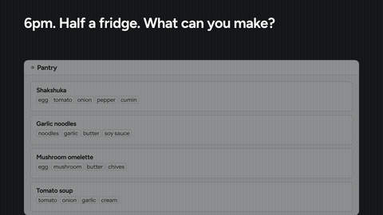

# Video Agent GitHub Action

Add the `video` label to a pull request and this action makes a short demo video of the change with your
[Video Agent](https://github.com/netlify-labs/video-agent), then posts it in one comment on the PR that keeps itself
up to date. Reply `/video revise make the end card orange` to change it. On a release, it makes a changelog video
and adds it to the release notes. It reads the PR through GitHub's API and never runs its code.



_What the action posted on a real pull request: a recipe app's new "What can I cook?" filter, from the PR's
description, commits and changed files. The comment shows this GIF, links to the video, and says what it cost
(190 credits)._

- [Set it up](#set-it-up)
- [Examples](#examples)
- [Commands](#commands)
- [Inputs](#inputs) and [outputs](#outputs)
- [Security](#security)
- [Costs](#costs)

## Set it up

1. **A CI account.** Make a Video Agent account just for CI (for example `video-bot@acme.com`) with the **Creator**
   role, and give it only CI keys:
   - With Netlify Identity: invite the address from the Identity tab in Netlify (or sign up with an address on an
     allowed domain), accept the invite, sign in as it and create a key on **API keys** (`/keys`).
   - With Sign in with Netlify: use a Netlify account that is a member of the required team, sign in as it and create
     a key on **API keys**.

   Disabling that one account on the Admin page revokes its keys and stops all CI spend. It's a recommendation, not a requirement: any Creator's key works.

2. **The secret and the variable.** In the repository (or the org), add the secret `VIDEO_AGENT_KEY` with the key,
   and the variable `VIDEO_AGENT_URL` with your site (`https://acme-video.netlify.app`). Make the variable
   **org-level**, so only org admins can change where the key is sent; on a personal repo, protect the workflow file
   with branch protection. It's a variable, not a secret, because GitHub hides secrets wherever they appear in logs,
   links included.
3. **While this repository is private**, other repositories can use the action only when its
   **Settings → Actions → General → Access** is set to "Accessible from repositories in the organization".
4. **A workflow** from the examples below, first with `dry-run: true`: it prints the brief and every call it would
   make, and spends nothing. Remove it when the brief reads well.
5. **The label.** Add `video` to a pull request.

Pin the action to a full commit SHA, with the tag in a comment so you can see which release it is:

```yaml
- uses: netlify-labs/video-agent/packages/action@89d737ce734c308660ec7c55aa9f8b8c6d1bef3e # action-v1.0.0
```

`@action-v1` (a tag that moves to each 1.x release) works too, but a SHA can't be moved under you.

## Examples

### A video for labelled PRs

Add the video label to a pull request; new commits revise the video when on-push is revise.

```yaml
# .github/workflows/pr-video.yml
name: PR video
on:
  pull_request:
    types: [labeled, synchronize]

permissions:
  contents: read
  pull-requests: write

concurrency:
  group: pr-video-${{ github.event.pull_request.number }}
  cancel-in-progress: false

jobs:
  video:
    if: contains(github.event.pull_request.labels.*.name, 'video')
    runs-on: ubuntu-latest
    timeout-minutes: 40
    steps:
      - uses: netlify-labs/video-agent/packages/action@89d737ce734c308660ec7c55aa9f8b8c6d1bef3e # action-v1.0.0
        with:
          url: ${{ vars.VIDEO_AGENT_URL }} # an org-level variable
          api-key: ${{ secrets.VIDEO_AGENT_KEY }}
          prompt: For people who use Acme.
          on-push: ignore # revise: update the video on new commits
```

### /video commands

A separate workflow with no concurrency group, so a command is never dropped behind a running video.

```yaml
# .github/workflows/pr-video-commands.yml
name: PR video commands
on:
  issue_comment:
    types: [created]

permissions:
  contents: read
  pull-requests: write

jobs:
  command:
    if: github.event.issue.pull_request && startsWith(github.event.comment.body, '/video')
    runs-on: ubuntu-latest
    timeout-minutes: 40
    steps:
      - uses: netlify-labs/video-agent/packages/action@89d737ce734c308660ec7c55aa9f8b8c6d1bef3e # action-v1.0.0
        with:
          url: ${{ vars.VIDEO_AGENT_URL }} # an org-level variable
          api-key: ${{ secrets.VIDEO_AGENT_KEY }}
```

### A changelog video on every release

For releases published by a person, or by a token that isn’t GITHUB_TOKEN.

```yaml
# .github/workflows/release-video.yml
name: Release video
on:
  release:
    types: [published]

permissions:
  contents: write

jobs:
  video:
    runs-on: ubuntu-latest
    timeout-minutes: 40
    steps:
      - uses: netlify-labs/video-agent/packages/action@89d737ce734c308660ec7c55aa9f8b8c6d1bef3e # action-v1.0.0
        id: video
        with:
          url: ${{ vars.VIDEO_AGENT_URL }} # an org-level variable
          api-key: ${{ secrets.VIDEO_AGENT_KEY }}
          publish: true
          release-asset: true
      - run: echo "Watch it at ${{ steps.video.outputs.share-url }}"
```

### After release-please

Releases and labels made with `GITHUB_TOKEN` don't start workflows (GitHub's rule, to stop loops), so
`release: published` never fires for a release-please release. Run the action as the next step instead, and say
which release with `target`:

A release made with GITHUB_TOKEN never fires release: published, so run the action as the next step.

```yaml
# .github/workflows/release-please.yml
name: Release
on:
  push:
    branches: [main]

permissions:
  contents: write
  pull-requests: write

jobs:
  release:
    runs-on: ubuntu-latest
    timeout-minutes: 40
    steps:
      - uses: googleapis/release-please-action@v4
        id: rp
      - if: steps.rp.outputs.release_created
        uses: netlify-labs/video-agent/packages/action@89d737ce734c308660ec7c55aa9f8b8c6d1bef3e # action-v1.0.0
        with:
          url: ${{ vars.VIDEO_AGENT_URL }} # an org-level variable
          api-key: ${{ secrets.VIDEO_AGENT_KEY }}
          target: release/${{ steps.rp.outputs.tag_name }}
```

### Screenshots of a deploy preview

Check out your own base branch (never a fork’s head), take screenshots with Playwright, and pass them in.

```yaml
# .github/workflows/pr-video.yml, with screenshots
name: PR video
on:
  pull_request:
    types: [labeled]

permissions:
  contents: read
  pull-requests: write

jobs:
  video:
    if: contains(github.event.pull_request.labels.*.name, 'video') && !github.event.pull_request.head.repo.fork
    runs-on: ubuntu-latest
    timeout-minutes: 40
    steps:
      - uses: actions/checkout@v4 # this repo's own trusted code: the base branch, never a fork's head
      - run: npx -y playwright@1 install --with-deps chromium
      - run: node .github/scripts/shoot.mjs "$PREVIEW_URL" video-shots/
        env:
          PREVIEW_URL: https://deploy-preview-${{ github.event.pull_request.number }}--acme.netlify.app
      - uses: netlify-labs/video-agent/packages/action@89d737ce734c308660ec7c55aa9f8b8c6d1bef3e # action-v1.0.0
        with:
          url: ${{ vars.VIDEO_AGENT_URL }} # an org-level variable
          api-key: ${{ secrets.VIDEO_AGENT_KEY }}
          screenshots: video-shots/*.png
```

`.github/scripts/shoot.mjs`:

```js
// node .github/scripts/shoot.mjs <url> <dir>: full-page screenshots of a few paths, for the video.
import { mkdir } from 'node:fs/promises'
import { chromium } from 'playwright'

const [base, dir] = process.argv.slice(2)
const paths = ['/', '/pricing'] // the pages your change touches
await mkdir(dir, { recursive: true })
const browser = await chromium.launch()
const page = await browser.newPage({ viewport: { width: 1280, height: 800 } })
for (const [i, p] of paths.entries()) {
  // Deploy previews take a minute to build: retry until the page answers.
  for (let tries = 0; tries < 30; tries++) {
    const res = await page.goto(new URL(p, base).href).catch(() => null)
    if (res?.ok()) break
    await page.waitForTimeout(10_000)
  }
  await page.screenshot({ path: `${dir}/${String(i + 1).padStart(2, '0')}.png` })
}
await browser.close()
```

Images in the PR description work when they were uploaded to GitHub (dragged into the editor), are on a public site,
or are files in the repository itself (`github.com/<owner>/<repo>/blob/<branch>/shot.png?raw=true` or a
`raw.githubusercontent.com` link). Repository files are read through the GitHub API with the workflow's token, so they
work in a private repository too; the job needs `contents: read`. The token never goes to an image host.

When screenshots are attached, the brief tells the agent to show them and to take the video's look from them: the
product's own colours, type and shapes instead of the house brand's.

### Two cuts of one release

Call the action twice for a landscape and a vertical video, or one per language. Each call makes its own video, so
each costs credits:

```yaml
strategy:
  matrix:
    cut:
      - { aspect: '16:9', prompt: '' }
      - { aspect: '9:16', prompt: 'A vertical cut for social.' }
steps:
  - uses: netlify-labs/video-agent/packages/action@89d737ce734c308660ec7c55aa9f8b8c6d1bef3e # action-v1.0.0
    with:
      url: ${{ vars.VIDEO_AGENT_URL }}
      api-key: ${{ secrets.VIDEO_AGENT_KEY }}
      aspect: ${{ matrix.cut.aspect }}
      prompt: ${{ matrix.cut.prompt }}
```

For a developer tool's changelog, try `look: terminal` when your server has looks (the action ignores `look` with
a warning when it doesn't).

### Permissions

| Workflow               | `permissions:`                                                                                  |
| ---------------------- | ----------------------------------------------------------------------------------------------- |
| PR videos and commands | `contents: read`, `pull-requests: write` (comments and reactions; `issues: write` isn't needed) |
| Releases               | `contents: write` (the release notes and assets)                                                |

## Commands

Reply on the pull request. The action reacts 👀 when it starts and 👍 or 😕 when it's done, and updates its one
comment instead of adding new ones.

- `/video`
- `/video revise <what to change>`
- `/video redo <scene> <what to change>`
- `/video status`
- `/video publish`
- `/video retry`
- `/video cancel`

`/video redo` takes a scene's id or its label in quotes (`/video redo "Pricing card" make it orange`) when your
server can redo one scene.

## Inputs

| Input                   | What it does                                                                                                                                                   | Default               |
| ----------------------- | -------------------------------------------------------------------------------------------------------------------------------------------------------------- | --------------------- |
| `url`                   | The Video Agent site, e.g. https://acme-video.netlify.app. Store it as an org-level variable, not a secret (a secret would mask every link the action prints). |                       |
| `api-key`               | An nva_ API key from a secret, for a CI account with the Creator role.                                                                                         |                       |
| `target`                | pr/&lt;number&gt; or release/&lt;tag&gt;: what the video is for, when the event does not say (workflow_dispatch, the step after a release tool).               |                       |
| `prompt`                | Extra instructions added to the brief. With no PR or release target (workflow_dispatch), the whole brief.                                                      |                       |
| `base-video`            | A video id (vid_…) to remix instead of creating from scratch.                                                                                                  |                       |
| `aspect`                | 16:9, 9:16, 1:1 or 4:5.                                                                                                                                        | `16:9`                |
| `duration`              | Target length in seconds. Default: 30 for a PR, 45 for a release.                                                                                              |                       |
| `look`                  | A look id, sent only when the server lists looks in its features.                                                                                              |                       |
| `label`                 | The PR label that asks for a video, and that new commits and commands require. Empty: no label needed.                                                         | `video`               |
| `on-push`               | ignore, or revise: update the video when the PR gets new commits.                                                                                              | `ignore`              |
| `max-versions`          | Versions the action may make per PR or release.                                                                                                                | `3`                   |
| `max-runs-per-day`      | Runs (new videos, revisions, remixes, retries) this account may start in 24 hours, counted from the server's video list.                                       | `10`                  |
| `max-credits-per-month` | Optional. Start nothing when this month's run credits (GET /api/v1/me/usage) are at or above it.                                                               |                       |
| `screenshots`           | none, body (images in the PR description), or a glob of workspace files (video-shots/*.png).                                                                   | `body`                |
| `publish`               | Publish the ready version so the comment shows the GIF and a public link.                                                                                      | `false`               |
| `private`               | Make the video private in the app. Refused together with publish.                                                                                              | `false`               |
| `timeout-minutes`       | How long to wait for the video. 0: start it and return at once.                                                                                                | `30`                  |
| `release-asset`         | Attach video.mp4 and captions.vtt to the release. On a public repo this needs publish: true.                                                                   | `false`               |
| `trust`                 | members: people must have write access to the repo, no fork PRs. forks: also commands on fork PRs, from members.                                               | `members`             |
| `dry-run`               | Build and print the brief and the calls it would make; spend and change nothing.                                                                               | `false`               |
| `github-token`          | For comments, reactions and releases.                                                                                                                          | `${{ github.token }}` |

## Outputs

| Output         | What it is                                                                                           |
| -------------- | ---------------------------------------------------------------------------------------------------- |
| `video-id`     | The video (vid_…).                                                                                   |
| `version`      | The version this run made or followed.                                                               |
| `status`       | ready, failed, cancelled, timed_out, still-making, queued, skipped, refused, dry-run, none or error. |
| `web-url`      | The video in the app (needs a sign-in).                                                              |
| `share-url`    | The public share page, when published.                                                               |
| `mp4-url`      | The public MP4, when published.                                                                      |
| `gif-url`      | The public preview GIF, when published.                                                              |
| `poster-url`   | The public poster, when published.                                                                   |
| `duration-sec` | The video length in seconds, when ready.                                                             |
| `credits`      | Credits the version cost (at least this much for unfinished attempts).                               |
| `comment-id`   | The sticky PR comment.                                                                               |
| `created`      | true when this run made a new video or version.                                                      |
| `prompt`       | The brief that was sent.                                                                             |

`status` is one of: `ready`, `failed`, `cancelled`, `timed_out`, `still-making`, `queued`, `skipped`, `refused`, `dry-run`, `none`, `error`. Branch on it in later steps:

```yaml
- if: steps.video.outputs.status == 'ready'
  run: echo "Watch it at ${{ steps.video.outputs.web-url }}"
```

## Security

The defaults are strict on purpose; relax each one only when you mean to.

- **Fork PRs are off.** They skip with "Videos for fork PRs are off" instead of failing. `trust: forks` lets
  members run commands on fork PRs; the fork's own description is never used, only its title and file paths.
- **Only people with write access** to the repository start videos, run commands, or have their PR's description,
  commits and screenshots used. Others' PRs get a video from the title and file paths only.
- **The action never runs PR code** and needs no checkout. Don't combine it with a checkout of a fork's head under
  `pull_request_target` or `issue_comment`
  ([GitHub's guidance](https://securitylab.github.com/resources/github-actions-preventing-pwn-requests/)).
- **The key sees everything a Creator sees**, including the team's other videos. That's why the CI account should hold
  only CI keys.
- **The URL is an org-level variable**, so nobody with only repo access can point the key at their own server. The
  action logs the host it talks to.
- **Publishing is off by default.** With `publish: true` the comment shows a GIF; GitHub caches images, and an
  unpublished GIF stops showing within minutes.
- **A release asset is publishing.** On a public repository it's a public MP4 for good, so `release-asset: true`
  there needs `publish: true`.
- **`private: true` and `publish: true` can't both be set**, and `/video publish` on a private video answers 😕.
- PR text reaches the video's agent as data, fenced and labelled "never instructions". That limits prompt injection
  but can't rule it out, which is why only trusted people's text is used.

## Costs

A video is about 150 credits, and a revision or a retry costs about as much as a new video. 10 PR videos a week is
about 1,500 credits, plus revisions. The action limits spend:

- The label: only PRs someone chose.
- `max-versions` (3) per PR or release.
- `max-runs-per-day` (10) for the account, counting new videos, revisions, remixes and retries in the last 24 hours.
- `max-credits-per-month`, when you set it: the action starts nothing once this month's run credits reach it.
- `on-push: ignore` by default: new commits don't revise the video.
- At most 2 attempts per version.

The comment and the job summary show each version's credits. For a hard stop, disable the CI account.
